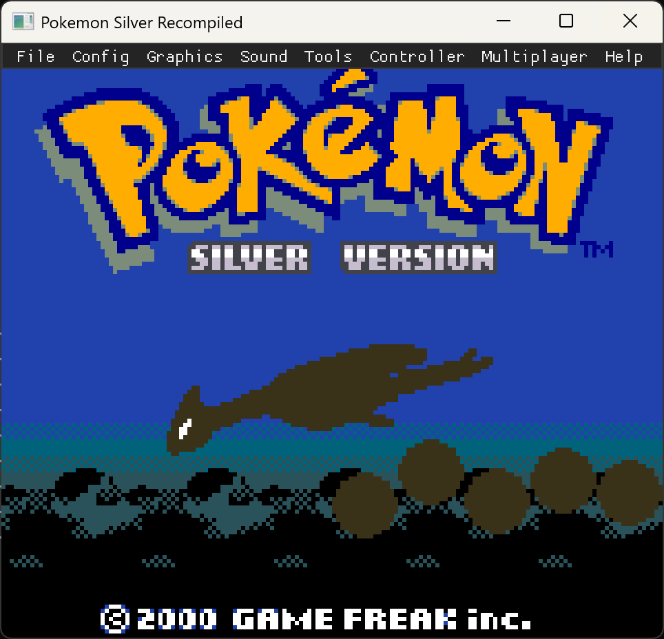
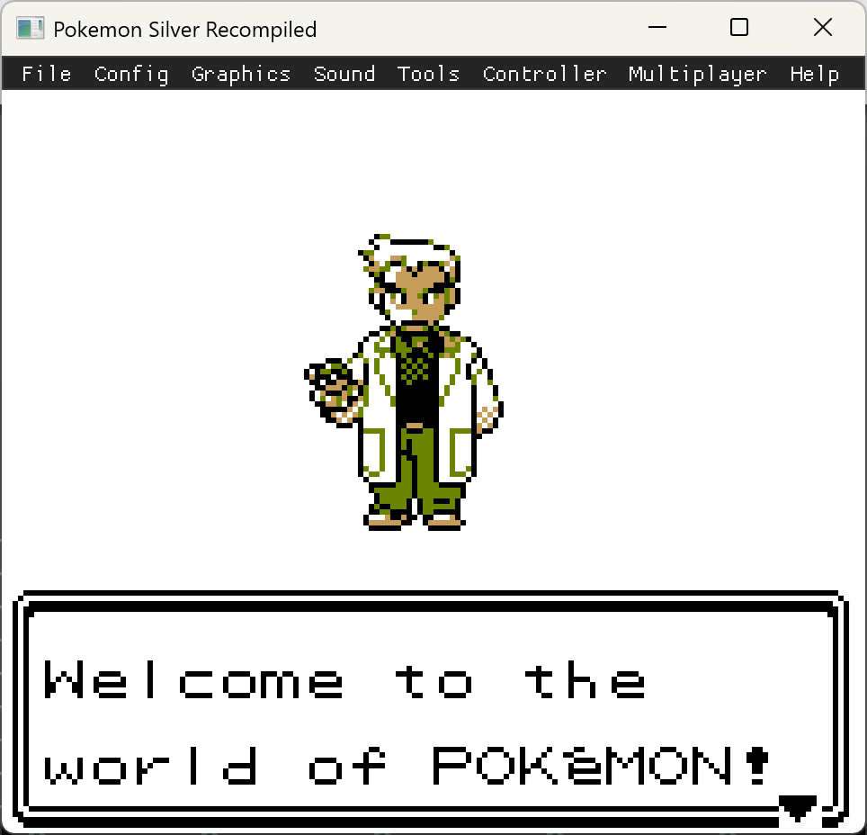
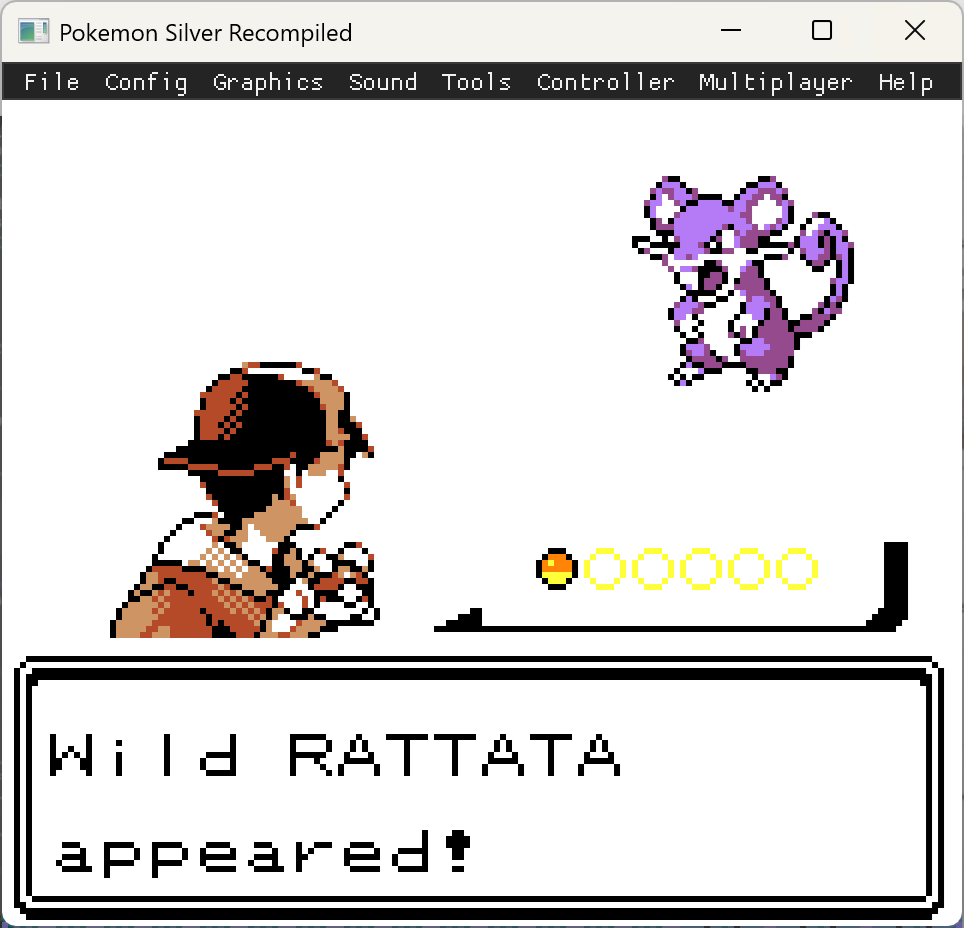
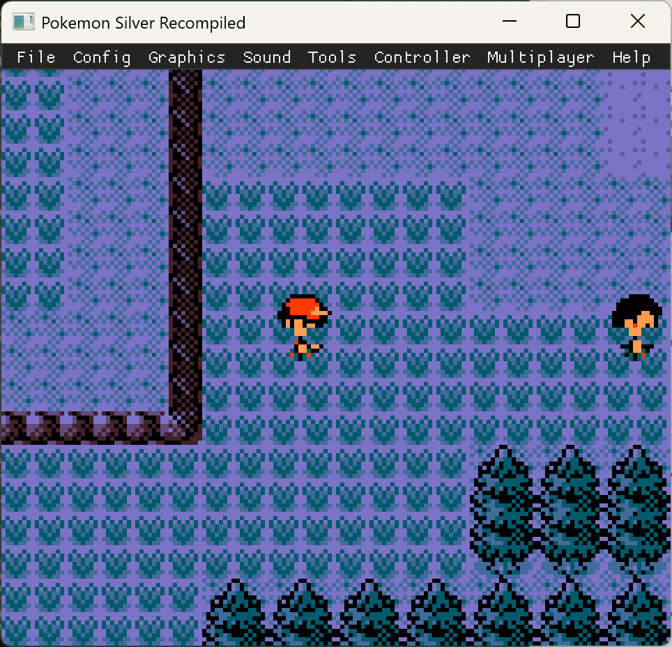

# Pokémon Silver — Statically Recompiled

> *Pokémon Silver as a native executable. No emulator, no ROM interpretation at runtime — just Color machine code translated ahead of time into portable C.*

This repository ports **Pokémon Silver Version (Game Boy Color, 1999/2000)** to native code via [**gb-recompiled**](https://github.com/sp00nznet/gb-recompiled). It's the third Gen 2 title attempted with this toolchain, after [pokemon-gold](https://github.com/sp00nznet/pokemon-gold) and [pokemon-crystal](https://github.com/sp00nznet/pokemon-crystal).

Silver shares its engine with Gold — the generated `rom.c` is essentially the same size (~58 MB; Crystal's is ~85 MB because Crystal adds the Suicune story arc, Unown content, and mobile-adapter scaffolding). The same MBC3+TIMER+RAM+BATTERY mapper (cart type 0x10), the same RTC `.rtc` sidecar mechanism, the same recipe.

|  |  |
|---|---|
|  |  |
| Lugia silhouette over the ocean — ©2000 GAME FREAK. | "Welcome to the world of POKéMON!" |
|  |  |
| Wild Rattata — Silver's early-route encounter table. | Overworld; player + NPC, CGB palettes, scrolling. |

---

## ✅ Status: First boot complete

| Milestone | Status |
| --- | :---: |
| Repo scaffolding (CMake, submodule, entry point) | ✅ |
| Cart identified: `POKEMON_SLVAAXE`, MBC3+TIMER+RAM+BATTERY | ✅ |
| Recompile (`gbrecomp` → 58 MB `rom.c` + 13 MB `rom_rom.c`) | ✅ |
| `rom.exe` builds under MSVC + vcpkg SDL2 (13.5 MB binary) | ✅ |
| First boot to title screen (visually confirmed) | ✅ |
| Intro dialogue + wild encounter + overworld render | ✅ |
| RTC persistence (same `.rtc` sidecar as Gold/Crystal) | ✅ |
| Add Silver row to `gb-recompiled/COMPATIBILITY.md` | ✅ |
| Day/night cycle visually confirmed | ⏳ user-test |
| Save round-trip a full party + box | ⏳ user-test |

---

## Building

Same toolchain as the sibling repos — see [pokemon-gold](https://github.com/sp00nznet/pokemon-gold) for the full prerequisite list. Quick path:

```bash
git clone --recurse-submodules https://github.com/sp00nznet/pokemon-silver.git
cd pokemon-silver
# Place your legally obtained Pokemon Silver ROM at roms/rom.gbc

# Build the toolchain (Windows MSVC + vcpkg shown; MinGW also works):
cmd /c '"<vcvars64.bat>" && cd gbrecomp && cmake -G Ninja -B build \
    -DCMAKE_TOOLCHAIN_FILE=C:/vcpkg/scripts/buildsystems/vcpkg.cmake \
    -DVCPKG_TARGET_TRIPLET=x64-windows && cmake --build build'

# Recompile your ROM:
./gbrecomp/build/bin/gbrecomp roms/rom.gbc -o .

# Build the game:
cmake -G Ninja -B build -DCMAKE_TOOLCHAIN_FILE=C:/vcpkg/scripts/buildsystems/vcpkg.cmake -DVCPKG_TARGET_TRIPLET=x64-windows
cmake --build build
./build/rom
```

Save data lives next to `rom.exe`: `POKEMON_SLVAAXE.sav` (cart RAM) and `POKEMON_SLVAAXE.rtc` (48-byte BGB-compatible RTC sidecar).

---

## Legal

This repository contains **zero** copyrighted Nintendo material. The generated `rom.c` / `rom_rom.c` files are derivatives of *your* ROM dump, never committed, never distributed. Repository code is MIT; the game is and remains the property of Nintendo / Game Freak / The Pokémon Company.

> *Pokémon and Game Boy are trademarks of Nintendo. Bring your own legally obtained ROM. We don't ship one. We never will.*

---

## Credits & Acknowledgements

- **Nintendo / Game Freak / Creatures Inc.** — for *Pokémon Silver* (1999/2000).
- **[arcanite24](https://github.com/arcanite24)** — original author of [gb-recompiled](https://github.com/arcanite24/gb-recompiled).
- **[sp00nznet/gb-recompiled](https://github.com/sp00nznet/gb-recompiled)** — our fork; where MBC3-RTC persistence, MSVC codegen portability, focus-vsync, and the neutralised window title all landed during the Gen 2 ports.
- **[pret](https://github.com/pret) / [pokegold disassembly](https://github.com/pret/pokegold)** — Gold and Silver share an engine; the symbolicated assembly is the same reference for both.
- **[LIJI32](https://github.com/LIJI32) & contributors** — *SameBoy* for timing accuracy reference.
- **[ocornut](https://github.com/ocornut)** — [Dear ImGui](https://github.com/ocornut/imgui).
- **[lsalzman](https://github.com/lsalzman)** — [ENet](https://github.com/lsalzman/enet).
- **[libsdl-org](https://github.com/libsdl-org)** — SDL2.
- **Prior art** — [sp00nznet/pokemon-gold](https://github.com/sp00nznet/pokemon-gold) and [sp00nznet/pokemon-crystal](https://github.com/sp00nznet/pokemon-crystal) (direct siblings) and [sp00nznet/LinksAwakening](https://github.com/sp00nznet/LinksAwakening) (the original stack reference).

If your work is here and the credit is wrong or missing, open an issue — happy to fix it.
